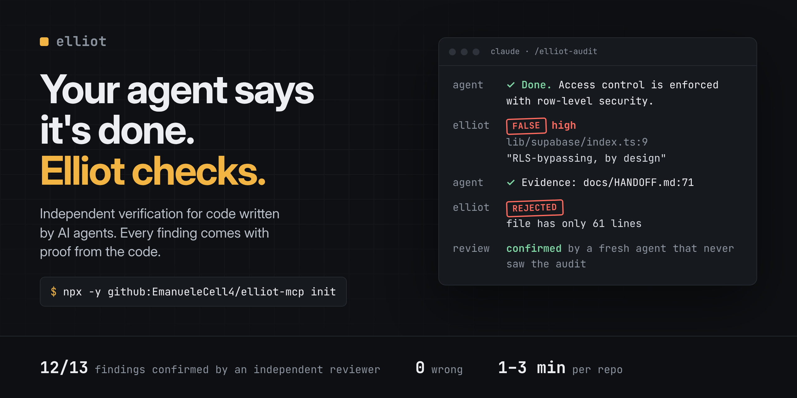
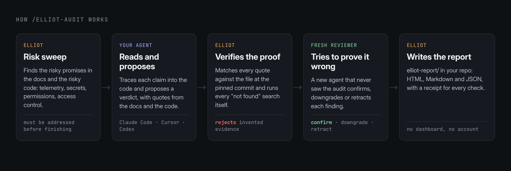
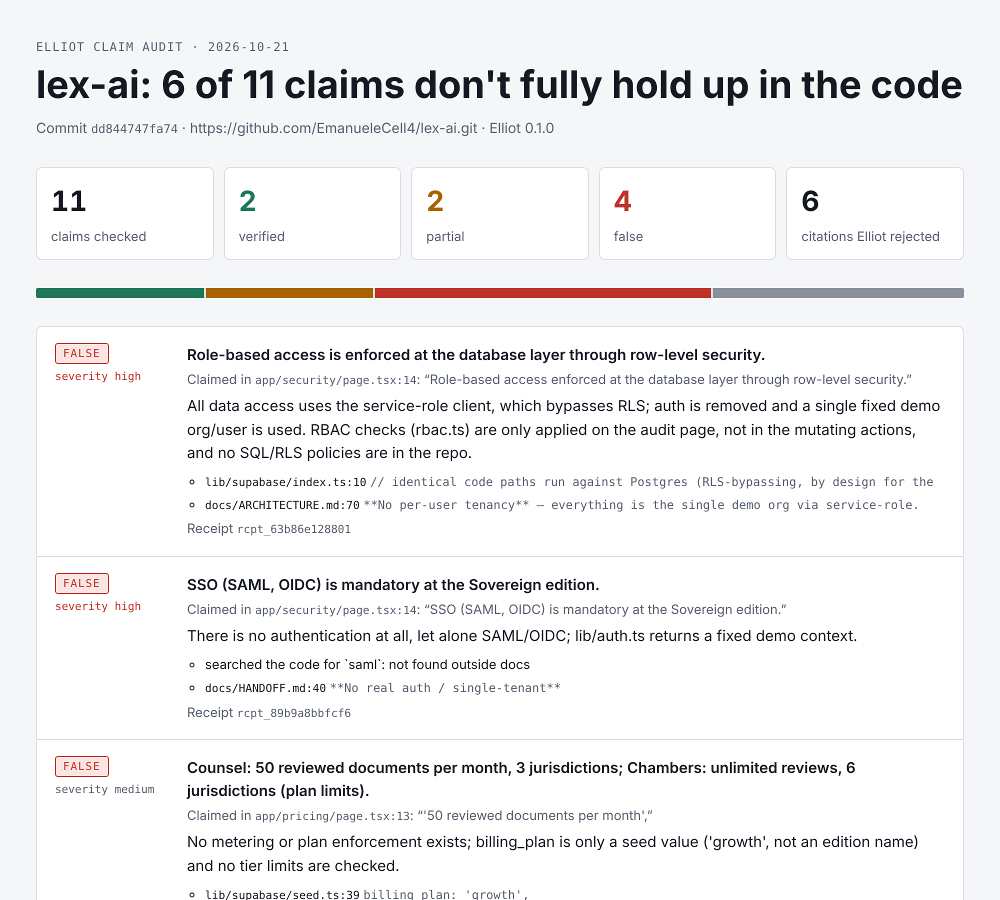

<p align="center">
  
</p>

<p align="center">
  <b>Independent verification for code written by AI agents.</b><br>
  Elliot checks what your agent claims, and what your README promises, against the code. Every finding comes with proof.
</p>

<p align="center">
  <a href="LICENSE"></a>
  <a href="https://glama.ai/mcp/servers/EmanueleCell4/elliot-mcp"></a>
  
  
  
</p>

<p align="center">
  <a href="#quick-start">Quick start</a> ·
  <a href="#what-it-found">What it found</a> ·
  <a href="#how-it-works">How it works</a> ·
  <a href="#commands">Commands</a> ·
  <a href="#configuration">Configuration</a> ·
  <a href="#faq">FAQ</a>
</p>

---

## Quick start

In the repository you want to check:

```bash
npx -y github:EmanueleCell4/elliot-mcp init
```

Restart your agent, then type:

```
/elliot-audit
```

A minute or three later the report is in `elliot-report/<date>-<commit>/` at the root of the repo: `report.html`, `report.md` and `claims.json`. There is nothing to open, no dashboard and no account.

Requirements: Node 20 or newer, git, and Claude Code, Cursor or Codex.

### As a Claude Code plugin

Inside Claude Code:

```
/plugin install elliot --marketplace EmanueleCell4/elliot-mcp
```

That adds the Elliot tools, a `/elliot:audit` command, and a skill that makes Claude verify its own "done" claims before reporting them.

### On every pull request (GitHub Action)

Elliot reads the pull request description, checks each claim against the code ("fixes X", "adds tests for Y", "no behaviour change"), and comments with the proof. If an agent wrote the PR, this is where its "done" gets checked.

```yaml
# .github/workflows/elliot.yml
name: Elliot
on:
  pull_request:
    types: [opened, edited, synchronize]
permissions:
  contents: read
  pull-requests: write
jobs:
  check:
    runs-on: ubuntu-latest
    steps:
      - uses: actions/checkout@v4
        with:
          fetch-depth: 0
      - uses: EmanueleCell4/elliot-mcp@v0.5.0
        with:
          anthropic_api_key: ${{ secrets.ANTHROPIC_API_KEY }}
```

The comment looks like this:

| Verdict | Claim | Proof |
|---|---|---|
| ❌ FALSE | Adds unit tests for the comment builder in test/comment.test.js | searched for `comment.test.js`: not found |
| ✅ VERIFIED | The badge is only offered when the audit has no findings | `src/audit-report.js:27` |

It runs Claude Code with your API key. One check usually takes 1–2 minutes. Nothing is sent anywhere except Anthropic's API and GitHub.

### README badge

When every claim Elliot checks holds up, the report includes a badge you can paste into your README:

[](https://github.com/EmanueleCell4/elliot-mcp)

## Why

Coding agents say "Done ✅" when the work isn't done. They delete failing tests, skip checks, describe security that doesn't exist, and write READMEs that promise what the code never does. CI stays green because tests check the code the agent wrote, not the promises the product makes.

I found this out the hard way. My own legal-tech app had a security page promising role-based access enforced in the database. The data layer bypassed it by design, and every permission check was a function that ignored its input. The agent had told me it was done.

The usual fix is to ask a second AI to review the first one. That gives you another opinion from the same kind of system that made the mistake. In the first automatic audit I ran, the agent doing the checking cited line numbers that don't exist in 4 of 17 submissions.

Elliot works the other way around: **the agent proposes, Elliot verifies.** Every quote must really be in the file, at that line, at that commit: the audit fingerprints the tree when it starts (tracked changes and untracked files included) and refuses evidence once anything changes, and symlinks that lead outside the repository are not evidence. Every "this doesn't exist" is searched by Elliot itself. A fresh reviewer then tries to prove each finding wrong before it reaches the report.

## What it found

<p align="center">
  
</p>

Elliot 0.3 ran unattended inside Claude Code on 9 popular open-source tools from the AI coding-agent ecosystem (October 2026). A separate reviewer that had not seen the audits then checked every finding against the code.

| Findings in the reports | Confirmed correct | Left unconfirmed by the reviewer | Wrong | Time per repo |
|---|---|---|---|---|
| 13 | 12 | 1 | 0 | 1 to 3 minutes |

"Wrong" means a factual error: the code does not show what the finding says.

Some of what it caught:

- A tool whose README says **"No Telemetry: no data collection or tracking"** ships analytics that are on by default, with consent pre-set to "yes". ([public issue](https://github.com/winfunc/opcode/issues/481))
- An app where **logging in turns telemetry back on** after the user switched it off, then identifies the user by email. ([public issue](https://github.com/BloopAI/vibe-kanban/issues/3482))
- A security page that calls a script sandbox **"read-only"** while the code can give scripts file writes and MCP tools. Confirmed by the project's triage bot, with a docs fix sent upstream. ([issue](https://github.com/dyad-sh/dyad/issues/4879), [PR](https://github.com/dyad-sh/dyad/pull/4881))
- Docs saying an **API key is stored encrypted** while the code writes it as plain JSON.
- A popular agent tool that sends users' **full AI prompts and responses to a third-party error tracker by default**, under an option named "anonymousTelemetry". Reported privately to the maintainers; details will be published after a fix.

What it still misses: on the same 9 repos it found 6 of the 10 serious issues I had found by hand beforehand (a small, hand-picked set, so read it as a rough coverage figure, not a recall estimate). The most common miss is a missing authorization check (for example, a download endpoint that doesn't check who is asking). Elliot doesn't look for those yet; see the [roadmap](#roadmap).

### Benchmark: Claude with Elliot vs Claude alone

Eight widely used SDKs, 18 broken promises planted by flipping a value behind a documented default, two runs per condition, same model and instructions. A blind judge checked every finding that was not a planted bug.

| | Claude alone | Claude + Elliot |
|---|---|---|
| Planted bugs found (2 runs) | 28 / 36 (78%) | 30 / 36 (83%) |
| False alarms (judged not real) | 21% of findings | 6% of findings |
| Real unplanted problems found | 8 | 5 |

Elliot raises about a third as many false alarms and finds slightly more planted bugs; Claude alone casts a wider net. When the two blind judges (Claude and Codex) disagreed, reading the code showed Codex had misstated the code 9 times: a second model is not a check unless something re-reads the source. Method, limits and all raw outputs: [`benchmark/planted-promises`](benchmark/planted-promises).

### Benchmark: can anyone re-check what the agent says it verified?

56 real bug fixes (28 tasks, Opus and Haiku). Every fix was correct and no agent claimed "done" falsely. But in **19 of 56 runs (34%)** the check the agent said it ran could not be re-run by anyone else: a deleted scratch script, a check described in prose, a path on the agent's own machine. The work was right; the evidence was gone. [`benchmark/done-claims`](benchmark/done-claims)

## How it works

<p align="center">
  
</p>

1. **Risk sweep (Elliot).** Before the agent reads anything, Elliot scans the docs for risky promises (telemetry, privacy, encryption, access control, sandboxes, "never", "by default") and the code for signals that often contradict them: analytics SDKs, permission bypasses such as `--dangerously-skip-permissions`, privileged database clients, secrets written to disk. The audit cannot finish until every one is addressed or skipped with a reason.
2. **Read and propose (your agent).** Your agent traces each claim into the code and proposes a verdict, quoting the docs and the code.
3. **Verify the proof (Elliot).** Each quote is matched against the file at the pinned commit, within two lines of where the agent said it is. Each "absent" claim is searched by Elliot with `git grep`. Citations that don't check out are rejected, and the agent has to fix them.
4. **Materiality test.** A FALSE or PARTIAL verdict must say what a user who trusts the docs would get wrong. Omissions, naming details and tiny delays become notes, not findings. Changelogs, roadmaps and internal developer docs are rejected as sources, because they are not promises to users.
5. **Independent review.** A fresh subagent that never saw the audit tries to prove every finding wrong, and confirms, downgrades or retracts it. Elliot will not write the report until every finding has been reviewed.
6. **Report.** HTML, Markdown and JSON in `elliot-report/`, plus a tamper-evident receipt for every check in `.elliot/receipts.jsonl`.

If you wrote code in the same session, the protocol tells the agent to run the audit in a fresh subagent, so the auditor is not the author.

## Example report

<p align="center">
  
</p>

The full report is in [`examples/lex-ai-report.html`](examples/lex-ai-report.html). It was produced by an earlier version, before the independent review step existed.

## Commands

### Set-up: `init`

```bash
npx -y github:EmanueleCell4/elliot-mcp init            # every agent it detects
npx -y github:EmanueleCell4/elliot-mcp init --claude   # only Claude Code
npx -y github:EmanueleCell4/elliot-mcp init --cursor   # only Cursor
npx -y github:EmanueleCell4/elliot-mcp init --codex    # only Codex
npx -y github:EmanueleCell4/elliot-mcp init --all      # all three
```

`init` is idempotent: running it twice changes nothing, and it never overwrites a command file you edited. It writes:

| Agent | MCP server registered in | Command added |
|---|---|---|
| Claude Code | `.mcp.json` (project) | `.claude/commands/elliot-audit.md` → `/elliot-audit` |
| Cursor | `.cursor/mcp.json` (project) | `.cursor/commands/elliot-audit.md` → `/elliot-audit` |
| Codex | `~/.codex/config.toml` | `~/.codex/prompts/elliot-audit.md` → `/prompts:elliot-audit` |

### Audit a repo: `/elliot-audit`

Run it in your agent from the repository root. In Claude Code and Codex, anything you type after the command is passed to the agent as extra instructions, for example `/elliot-audit focus on the security page`.

### Check a "done" claim

The same server also checks individual claims while the agent works. It ships instructions telling the agent to use them before it says "done".

| The agent says | Tool | What Elliot looks at |
|---|---|---|
| "I fixed / cleaned / refactored the code" | `elliot_snapshot`, then `verify_changes` | the content hash of every file before and after the task |
| "The behavior works" | `verify_outcome` | runs the requested test command in a temporary OS sandbox; only exit code 0 is VERIFIED |
| "It's deployed / live" | `verify_url` | the HTTP status and the text really served at the URL |
| "PR merged", "CI is green", "pushed" | `verify_github` | the GitHub API: merge state, check runs, whether the commit exists |
| "Published to npm" | `verify_npm` | the npm registry: version exists, published after a given time |
| "What did my agent really do today?" | `elliot_report` | your receipts: claims checked, how many held up |

These checks answer `VERIFIED`, `NOT_VERIFIED` or `INCONCLUSIVE`. Inconclusive means Elliot could not confirm, for example because of a GitHub rate limit. It never guesses.

### All MCP tools

| Tool | Used by | What it does |
|---|---|---|
| `elliot_audit_start` | the agent | Pins the commit, lists the files that make claims, runs the risk sweep, returns the protocol. |
| `elliot_record_claim` | the agent | Records one claim with a verdict. Checks the source quote, every evidence quote and every absence search. |
| `elliot_record_behavior` | the agent | Records risky code behaviour the docs never mention, with checked code quotes. |
| `elliot_review_packet` | the agent | Returns a self-contained prompt for a fresh reviewer subagent. |
| `elliot_record_review` | the reviewer | Confirms, downgrades or retracts a finding. A retraction needs a code quote. |
| `elliot_audit_finish` | the agent | Refuses to finish while risk-sweep items or reviews are missing, then writes the report. |
| `elliot_snapshot` | the agent | Fingerprints the working tree before a task. |
| `verify_changes` | the agent | Compares the tree with a snapshot, or with HEAD. |
| `verify_outcome` | the agent | Runs a command and arguments against a disposable copy, with writes confined to the copy and network blocked. |
| `verify_attestation` | anyone | Checks an Ed25519 signature and receipt digest, optionally against a separately trusted public key. |
| `verify_url` | the agent | Checks status and expected text at a URL. |
| `verify_github` | the agent | Checks `pr_merged`, `checks_passing` or `commit_exists`. |
| `verify_npm` | the agent | Checks a package version on the registry. |
| `elliot_report` | you | Summarises recent receipts. |

### Verdicts in an audit

| Verdict | Meaning |
|---|---|
| `VERIFIED` | The code implements the claim. A small gap that misleads nobody is kept as a note. |
| `PARTIAL` | Implemented, with a gap that would make a user who relies on it do something wrong. |
| `FALSE` | The code contradicts the claim, or the feature, command, flag or option does not exist. |
| `UNVERIFIABLE` | Depends on a deployment, a contract or a service outside the repo. |
| `UNDISCLOSED` | Risky behaviour in the code that the docs never mention. |

## Manual installation

Use this if you'd rather not run `init`.

**Claude Code**

```bash
claude mcp add elliot -- npx -y github:EmanueleCell4/elliot-mcp
```

**Codex** (`~/.codex/config.toml`)

```toml
[mcp_servers.elliot]
command = "npx"
args = ["-y", "github:EmanueleCell4/elliot-mcp"]
```

**Cursor** (`.cursor/mcp.json`) and any other MCP client

```json
{ "mcpServers": { "elliot": { "command": "npx", "args": ["-y", "github:EmanueleCell4/elliot-mcp"] } } }
```

Then add the command yourself, or ask your agent to "run an Elliot claim audit of this repository". For agents that support skills, also add [`skills/elliot/SKILL.md`](skills/elliot/SKILL.md).

## Configuration

All settings are optional environment variables.

| Variable | Default | What it does |
|---|---|---|
| `GITHUB_TOKEN` | unset | Used by `verify_github` for private repos and higher rate limits. |
| `ELLIOT_DIR` | `.elliot/` in the working directory | Where receipts and audit state are stored. |
| `ELLIOT_GITHUB_API` | `https://api.github.com` | GitHub API base URL, for GitHub Enterprise or tests. |
| `ELLIOT_NPM_REGISTRY` | `https://registry.npmjs.org` | Registry used by `verify_npm`. |
| `ELLIOT_SIGNING_KEY` | unset | Path to an Ed25519 PKCS#8 private key. When set, every saved receipt is signed. Keep it outside the repository. |
| `ELLIOT_SIGNER_ID` | public-key fingerprint | Human-readable signer label included in signed receipts. The label is not an identity proof by itself. |
| `ELLIOT_ROLE` | unset | Set to `reviewer` for a separate reviewer-only MCP server process. |
| `ELLIOT_REVIEW_TOKEN` | unset | Enables isolated review mode; configure the same non-empty secret on auditor and reviewer server processes. |

## Network access and data

Elliot has no telemetry and no server of its own. What it touches:

- **Audit (`/elliot-audit`, `/elliot:audit`):** reads files in the repository and runs `git` locally. It makes no network calls.
- **`verify_url`:** sends one GET request to the URL the agent passes in. Loopback, private-network and link-local addresses (including cloud metadata) are refused on every redirect hop unless you set `ELLIOT_ALLOW_PRIVATE_URLS=1`; one 15-second deadline covers the whole request and the body stops at 2 MiB.
- **`verify_github`:** calls `api.github.com` (or `ELLIOT_GITHUB_API`). If a GitHub token is set (the `GITHUB_TOKEN` env var, or the plugin's optional `github_token` setting), it is sent only to that API.
- **`verify_npm`:** calls `registry.npmjs.org` (or `ELLIOT_NPM_REGISTRY`).
- **GitHub Action:** runs Claude Code in your CI with your `ANTHROPIC_API_KEY`, reads the PR description and code, and posts one comment through the GitHub API.
- **On disk:** receipts in `.elliot/` (or `ELLIOT_DIR`) and reports in `elliot-report/`, both inside your repository.

The Claude Code plugin runs the server bundled in this repository (`node src/index.js`). Claude Code installs its two npm dependencies from `package-lock.json` when you install the plugin.

## Output

```
your-repo/
├── elliot-report/
│   └── 2026-10-22-dd84474/
│       ├── report.html     # open in a browser
│       ├── report.md       # paste into an issue or PR
│       └── claims.json     # everything, for scripts and CI
└── .elliot/
    ├── receipts.jsonl      # one tamper-evident receipt per check
    └── audits/             # audit state
```

Add `.elliot/` to `.gitignore`. Commit `elliot-report/` if you want the report to live with the code.

A receipt looks like this:

```json
{
  "elliot": "0.3.0",
  "id": "rcpt_3f9a1c2b7d10",
  "check": "claim",
  "claim": "Role-based access is enforced at the database layer through row-level security.",
  "target": "lex-ai@dd84474",
  "verdict": "FALSE",
  "reason": "All data access uses the service-role client, which bypasses RLS.",
  "evidence": { "source": { "file": "app/security/page.tsx", "line_start": 14 }, "evidence": [ { "file": "lib/supabase/index.ts", "line_start": 10 } ] },
  "checked_at": "2026-10-21T19:42:11.000Z",
  "checker": "local",
  "digest": "sha256:…"
}
```

The digest detects changes to a receipt. For third-party verification, configure a private key outside the repository:

```bash
openssl genpkey -algorithm Ed25519 -out "$HOME/.elliot-signing-key.pem"
chmod 600 "$HOME/.elliot-signing-key.pem"
export ELLIOT_SIGNING_KEY="$HOME/.elliot-signing-key.pem"
export ELLIOT_SIGNER_ID="acme-ci"
```

Saved receipts then include the Ed25519 public key, its SHA-256 fingerprint, signer label and signature. A verifier checks the digest and signature with `verify_attestation`; `valid` is true only when a separately trusted public key is supplied and matches. Without that key, the verifier reports cryptographic validity while marking signer identity untrusted. The embedded key proves which key made the signature, not that the key belongs to a particular person or organization. Publish or distribute the trusted public key through a channel your verifiers already trust. Protect and back up the private key outside the repo. Receipts created without `ELLIOT_SIGNING_KEY` remain unsigned for compatibility.

### Isolated review

For enforced reviewer separation, run Elliot twice with the same `ELLIOT_DIR` and a private `ELLIOT_REVIEW_TOKEN` (generate one with `openssl rand -hex 32`). The auditor process uses `ELLIOT_ROLE=auditor`; the independent reviewer process uses `ELLIOT_ROLE=reviewer`. The auditor server omits `elliot_record_review`; the reviewer server exposes only that tool. `elliot_review_packet` gives the reviewer the finding, checked quotes, impact and an audit-scoped capability, without repository access or the auditor's explanation. Elliot encrypts the capability in audit state, checks its hash and the reviewer server credential on submission, and rejects cross-audit reuse and duplicate decisions. Keep the shared `ELLIOT_REVIEW_TOKEN` in the two host configurations; only the single-audit capability travels in the review packet.

```json
{
  "mcpServers": {
    "elliot-auditor": {
      "command": "node", "args": ["/path/to/elliot-mcp/src/index.js"],
      "env": { "ELLIOT_ROLE": "auditor", "ELLIOT_REVIEW_TOKEN": "<same-random-secret>", "ELLIOT_DIR": "/path/to/project/.elliot" }
    },
    "elliot-reviewer": {
      "command": "node", "args": ["/path/to/elliot-mcp/src/index.js"],
      "env": { "ELLIOT_ROLE": "reviewer", "ELLIOT_REVIEW_TOKEN": "<same-random-secret>", "ELLIOT_DIR": "/path/to/project/.elliot" }
    }
  }
}
```

The host must give the reviewer only the packet and the reviewer MCP connection. The default unconfigured mode retains the original combined tool surface for existing MCP clients. Separate processes and tool permissions enforce the boundary; deployments where the auditor can read reviewer host configuration or impersonate its MCP connection do not provide a separate trust domain.

### Functional outcome checks

Call `verify_outcome` with an executable and argument array, for example `command: "npm", args: ["test"]`. Elliot copies the working tree to a temporary directory, then runs the command in the OS sandbox (`sandbox-exec` on macOS or `bwrap` on Linux), with network access blocked and writes limited to the temporary copy. A zero exit code is `VERIFIED`; a failing check is `NOT_VERIFIED`. If the OS sandbox is unavailable, the result is `INCONCLUSIVE` and the command is not run. Dependencies already present in `node_modules` are copied into the temporary tree. No shell expansion is performed; pass flags as separate arguments.

## FAQ

**Isn't this just an LLM judging an LLM?**
No. The agent proposes verdicts, but every piece of evidence is checked deterministically: quotes against files at a pinned commit, absences with Elliot's own `git grep`. A second agent that never saw the audit reviews every finding, and a retraction has to be backed by a code quote that Elliot also checks.

**Does it send my code anywhere?**
Elliot itself makes no network calls during an audit. It reads files and runs git locally. Your agent reads the code as it normally does, with the model you already use. The `verify_url`, `verify_github` and `verify_npm` checks call those services only when the agent uses them.

**Does it change my code?**
No. It writes only `.elliot/` and `elliot-report/`, and `init` writes the config files listed above.

**What does it cost?**
Nothing. Elliot is MIT-licensed and the audit runs on the agent and model you already pay for. An audit of a medium-sized repo took 1 to 3 minutes in our tests.

**Can it audit private repos?**
Yes. It runs where your code is. Only `verify_github` needs `GITHUB_TOKEN` for private repos.

**Can I trust a PASS?**
Treat a clean report as "nothing found among the claims checked", not as a certificate. The claim audit is a static reading of the code; it does not run your app (use `verify_outcome` for that). Authorization checks are covered only where sibling handlers check the caller and one does not; ownership checks are not covered yet.

**I found a false positive.**
Please open an issue with the report's `claims.json` entry. False positives are the number Elliot is built to keep at zero.

## Roadmap

- [x] File, URL, GitHub and npm checks with local receipts
- [x] `/elliot-audit`: claim audit with checked citations, report in `elliot-report/`
- [x] Risk sweep, undisclosed behaviours, materiality test and independent review
- [x] Authorization gaps: handlers that skip the auth check their sibling handlers perform
- [ ] Ownership checks: handlers that check the caller is logged in but not that they own the record
- [x] Run functional outcome checks in an OS sandbox
- [ ] Hooks that run Elliot automatically when the agent stops (Claude Code, Codex)
- [x] A GitHub Action that checks the claims in each pull request description
- [x] Ed25519 signed receipts with offline verification

## Development

```bash
git clone https://github.com/EmanueleCell4/elliot-mcp && cd elliot-mcp
npm install
npm test     # 35 tests, including end-to-end runs that drive the server over stdio with the MCP client
```

The server is plain Node (ES modules) with two dependencies: the MCP SDK and zod. The main pieces:

| File | What it does |
|---|---|
| `src/index.js` | MCP server, tool definitions, `init` entry point |
| `src/audit.js` | Audit state, citation checks, review gate, verdict resolution |
| `src/risk.js` | Risk sweep: risky doc promises and code signals |
| `src/audit-protocol.js` | The protocol the agent follows |
| `src/audit-report.js` | HTML and Markdown reports |
| `src/init.js` | Registers Elliot in Claude Code, Cursor and Codex |
| `src/checks/` | `verify_changes`, `verify_outcome`, `verify_url`, `verify_github`, `verify_npm` |

Issues, false positives and stories of agents telling you they were done are very welcome.

## License

[MIT](LICENSE) © 2026 Emanuele Cella
